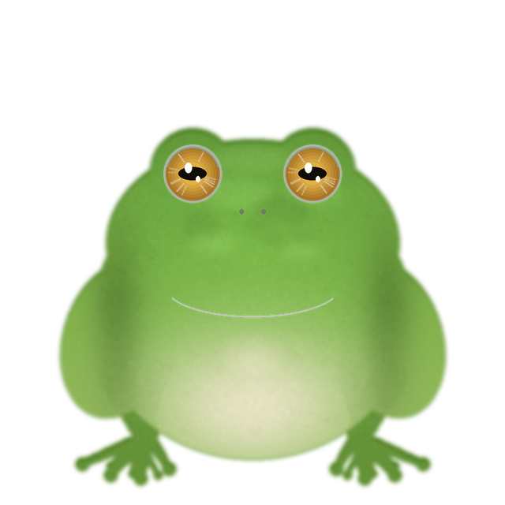

# FrogPet — 桌面青蛙宠物 🐸

一只会在桌面上跳来跳去、点了会"呱"的写实树蛙。Windows 桌面宠物，单文件 exe，双击即用。



## 功能总览

| 功能 | 实现 |
|---|---|
| 随机跳跃 | 抛物线轨迹、方向距离随机、起跳/腾空/落地三段动画、屏幕边缘自动回避 |
| 待机动画 | 呼吸起伏、随机眨眼、鼓腮（鸣囊）、接触阴影 |
| 脚下池塘 | 随身小水塘：岸边、水面渐变、荷叶、石子、环境涟漪；跳跃时留在地面，落地回到池塘 |
| 水花 | 起跳溅小水花、落地/拖拽放下溅大水花（水珠抛物线 + 扩散涟漪 + 白色水冠），配轻柔"扑通"声 |
| 鼠标拖拽 | 按住蛙身可拖到任意位置（含跨屏），松手落地缓冲 + 溅水花；按下即抓取、松手若未移动视为点击 |
| 点击回应 | 气泡文字（呱~/干嘛~/别戳我~…）、轻柔蛙鸣（合成 wav）、转向看鼠标、原地小跳 |
| 置顶穿透 | 始终在所有窗口上方；透明区域鼠标穿透，只有点到蛙身可交互（池塘也可穿透） |
| 不打扰 | 无边框、不抢焦点、无任务栏图标、不进 Alt-Tab、无托盘、无任何关闭按钮 |
| 关闭方式 | **唯一退出方式：全局热键 `Ctrl+Alt+Q`**（任何焦点下都有效） |
| 开机自启 | 首次运行自动安装到 `%LOCALAPPDATA%\FrogPet` 并写入 `HKCU\...\CurrentVersion\Run` |
| 多显示器 | 支持；默认在鼠标所在屏活动，偶尔跳去相邻屏幕，拖拽可跨屏搬家 |
| 隐私安全 | 完全离线、不联网、不收集数据、只写 HKCU（无需管理员权限） |

> ⚠️ 发给别人前，请告知对方：**按 `Ctrl+Alt+Q` 退出**；**卸载运行 `uninstall.bat`**。请仅在对方知情同意的电脑上使用。

## 目录结构

```
FrogPet/
├── main.py              # 入口：单实例、日志、首次安装、热键、主窗口
├── pet_window.py        # 透明置顶窗口、状态机(待机/起跳/腾空/落地/交互)、点击穿透
├── animation.py         # 素材加载、镜像/alpha 缓存、缓动函数
├── hotkey.py            # Ctrl+Alt+Q 全局热键 (Win32 RegisterHotKey, 无第三方依赖)
├── autostart.py         # HKCU Run 自启 + 首次安装(复制到 LOCALAPPDATA 后重启自身)
├── config.py            # 配置读写 (%LOCALAPPDATA%\FrogPet\config.json)
├── paths.py             # 路径工具 (兼容 PyInstaller onefile 的 _MEIPASS)
├── build.bat            # 一键打包脚本
├── uninstall.bat        # 一键卸载 (结束进程 + 删自启 + 删程序目录)
├── assets/
│   ├── frog/            # frog_idle / frog_blink / frog_puffed / frog_jump.png
│   │                    # + shadow.png + frog.ico   (640x640 RGBA 主图)
│   └── sounds/          # croak1~3.wav (程序合成的轻柔蛙鸣, 峰值 0.22)
├── tools/
│   ├── render_frog.py   # 参数化青蛙渲染器 (生成 assets/frog/*)
│   ├── make_sounds.py   # 蛙鸣合成器 (生成 assets/sounds/*)
│   └── test_pet.ps1     # 自动化验收: 点击/跳跃/热键退出
└── dist/
    └── FrogPet.exe      # 打包产物 (单文件, ~47MB)
```

## 快速开始

### 运行（源码）

```bat
:: 推荐 Python 3.11+ (本项目在 3.12 验证)
pip install PySide6
python main.py
```

### 打包（生成 dist\FrogPet.exe）

```bat
pip install PySide6 pyinstaller
build.bat
:: 或直接执行:
python -m PyInstaller --noconsole --onefile --clean -y --name FrogPet ^
  --icon assets\frog\frog.ico --add-data "assets;assets" ^
  --exclude-module PySide6.QtQml --exclude-module PySide6.QtQuick ^
  --exclude-module PySide6.QtNetwork --exclude-module PySide6.QtMultimedia ^
  main.py
```

> 想进一步降低杀软误报可改用 `--onedir`（生成目录版，误报率更低），或对 exe 做代码签名。

### 分发与卸载

- 把 `dist\FrogPet.exe` 发给对方 → 双击 → 青蛙出现并已设好开机自启。
- 退出：`Ctrl+Alt+Q`（只退出本次运行，自启保留）。
- 彻底卸载：运行 `uninstall.bat`（删除自启项 + `%LOCALAPPDATA%\FrogPet`）。

### 配置项

安装目录 `%LOCALAPPDATA%\FrogPet\config.json`（首次运行自动生成）：

```json
{
  "size": 170,          // 青蛙显示高度 px，建议 120~220
  "jump_min": 2.0,      // 跳跃间隔下限（秒）
  "jump_max": 6.0,      // 跳跃间隔上限（秒）
  "sound": true,        // 点击/落水是否发声
  "bubbles": true,      // 气泡文字开关
  "multi_screen": true, // 是否允许跳到其他显示器
  "shadow": true,       // 接触阴影
  "pond": true          // 脚下小池塘与落水水花
}
```

改完保存，重启程序生效。

---

## 素材规格

### 当前实现：姿态帧方案（4 帧 + 覆盖层）

本项目的动画 = **少量关键姿态帧 + 程序化变形**（缩放/挤压/旋转/交叉淡化），比逐帧序列更小巧且帧间完全一致。

| 文件 | 内容 | 规格要求 |
|---|---|---|
| `assets/frog/frog_idle.png` | 待机坐姿（睁眼） | 640×640 RGBA 透明 PNG |
| `assets/frog/frog_blink.png` | 闭眼（覆盖层） | 同上，**与 idle 仅眼睛不同** |
| `assets/frog/frog_puffed.png` | 鼓腮鸣囊（覆盖层） | 同上，**与 idle 仅喉部不同** |
| `assets/frog/frog_jump.png` | 腾空伸展 | 同上，脚底与 idle 大致同一基准线 |
| `assets/frog/shadow.png` | 接触阴影 | 480×160 RGBA |
| `assets/frog/frog.ico` | 图标 | 多尺寸 16~256 |

硬性约定：

1. **透明通道必须干净**：PNG-32（RGBA），蛙体外 alpha=0，边缘无白边/彩边；
2. **脚底基准线一致**：四帧中脚底都在源图同一高度（当前实现为 y≈608/640），否则落地会"陷进桌面"或"悬空"；
3. **比例一致**：四帧蛙身大小必须相同（同一只蛙的连续动作，不是四张独立画）；
4. **显示尺寸**：源图整体缩放到 `config.size`（120~220px），源图越大缩小后越清晰，建议 ≥512px；
5. **朝向**：正面视角即可；程序通过水平镜像区分左右（若素材侧脸，请统一朝左或朝右，程序会镜像）。

### 可选升级：序列帧方案

如果想换成逐帧动画（更细腻），目录约定：

```
assets/frog/
├── idle/idle_000.png ... idle_023.png   # 呼吸循环 24帧 @12fps
├── jump/jump_000.png ... jump_011.png   # 起跳-腾空-落地 12帧 @24fps
└── blink/blink_000.png ... blink_005.png
```

在 `animation.py` 的 `Sprites` 中把"单图"换成"目录帧列表"，`pet_window.py` 的 `_pose_mix` 返回帧号即可，窗口逻辑无需改动。

---

## AI 绘图提示词（生成写实青蛙素材）

> 生成后需要抠图（透明背景）。建议用支持透明的模型（SD + RemBG / DALL·E 透明输出 / remove.bg），
> 或生成纯品红/纯白背景后用 `tools/` 里的色键思路处理。**同一组素材务必同种子/同模型/同参数生成**，
> 或先生成 idle 再以它为底图 img2img 改姿态，保证是"同一只蛙"。

**基础角色（每条提示词都带上，保持一致性）：**

```text
Use case: photorealistic-natural
Asset type: desktop pet sprite, full-body isolated subject
Primary request: an adorable realistic green tree frog, front view, full body,
    macro photography quality
Subject: plump small tree frog, moist glossy skin covered in fine granular bumps,
    smooth wet sheen, vibrant yellow-green gradient dorsum (deep green back fading
    to bright chartreuse flanks), pale cream belly and throat, huge round glossy
    golden-amber eyes with dark horizontal pupils and bright catchlights,
    rounded sticky toe pads, subtle dark lateral stripe along the flank
Style/medium: photorealistic macro photo, 3D-render crispness
Lighting/mood: soft studio light from upper left, gentle wet specular highlights,
    friendly and cute but lifelike, not scary
Color palette: yellow-green + chartreuse + cream belly + amber eyes
Constraints: whole frog fully inside frame, centered, feet clearly visible,
    no shadow on background, no props, no text, no watermark
Avoid: cartoon, chibi, oversized head, human-like expression, blur, cluttered background
```

**逐姿态追加描述（替换 Primary request 的动作部分）：**

| 帧 | 追加动作描述 |
|---|---|
| `frog_idle` | `sitting upright on its haunches, front legs planted straight, eyes open, calm relaxed pose` |
| `frog_blink` | `identical pose and framing as the idle shot, eyes fully closed, smooth eyelids, everything else pixel-identical` |
| `frog_puffed` | `identical pose as idle, vocal sac under the chin inflated into a round pale balloon, cheeks puffed, eyes slightly squinted` |
| `frog_jump` | `mid-air leap, hind legs fully extended pushing off, front legs reaching forward, body stretched tall, toes spread wide` |

**负面提示词（SD 系）：**

```text
cartoon, chibi, kawaii sticker style, 2D flat, painting, sketch, deformed legs,
extra limbs, missing eyes, red eyes (恐怖向), open mouth teeth, wet floor, shadow,
background scenery, gradient background, text, watermark, jpeg artifacts
```

**实用技巧：**

- 眼睛是最容易翻车的地方： horizontally-long pupils（横向瞳孔）比竖瞳/圆瞳更像真蛙；
- 用 `same frog, same camera, only change ...` 的 img2img（低重绘幅度 0.3~0.5）做其余三帧；
- 生成后裁剪到内容包围盒、统一缩放到 640×640、把脚底对齐到 y≈608，再覆盖 `assets/frog/` 同名文件即可，无需改代码；
- 重跑 `tools/render_frog.py` 会**重新生成占位素材**（会覆盖同目录文件），替换素材后不要再运行它。

---

## 行为/技术要点（写给改代码的人）

- **状态机**：`pet_window.py` 中 `IDLE → CROUCH → JUMP → LAND → IDLE`，点击/拖拽进入 `INTERACT/DRAG`；30ms 定时器驱动，位置沿抛物线 `A→B - (0, 4h·t(1-t))` 插值。
- **拖拽**：按下记录抓取偏移，移动超过 8px 进入 `DRAG`（窗口实时跟随光标），松手夹回屏幕范围内并触发落地缓冲 + 水花；未移动的按下-松开视为点击。
- **池塘与水花**：池塘是纯 QPainter 绘制（岸边环 + 径向渐变水面 + 荷叶/石子 + 涟漪圈），画在地面点（跳跃时与阴影一样留在地面）；水珠粒子带重力、涟漪环扩散渐隐，起跳小溅、落地大溅。
- **点击穿透**：30ms 轮询光标位置 → 逆变换回姿态源图采样 alpha → 动态增删 `WS_EX_TRANSPARENT`（`WS_EX_LAYERED` 由 Qt 半透明窗口自带），因此"透明处穿透、蛙身可点"。
- **不抢焦点**：`WA_ShowWithoutActivating` + `WS_EX_NOACTIVATE | WS_EX_TOOLWINDOW`（后者同时把它移出 Alt-Tab 和任务栏）。
- **全局热键**：`RegisterHotKey(MOD_CONTROL|MOD_ALT, 'Q')` + 独立 `GetMessage` 线程，`WM_HOTKEY` 通过 Qt 信号回到主线程退出；不依赖 keyboard/pynput，无需管理员。
- **开机自启**：仅写 `HKCU\...\Run`，值为安装副本 `"C:\Users\<user>\AppData\Local\FrogPet\FrogPet.exe"`；热键退出不清除它。
- **首次安装**：frozen 状态下运行 `dist\FrogPet.exe` → 复制自身到 `%LOCALAPPDATA%\FrogPet` → 写自启 → `DETACHED_PROCESS` 重启安装副本 → 原进程退出。
- **声音**：`winsound.PlaySound(SND_ASYNC)` 播放预合成的轻柔蛙鸣（3 个变体，随机挑选）；想换声音直接替换 `assets/sounds/croak*.wav`（16bit PCM mono 44.1kHz）。
- **日志**：`%LOCALAPPDATA%\FrogPet\log.txt`，排查问题先看它。

## 常见问题

| 现象 | 处理 |
|---|---|
| 双击没反应 | 查 `%LOCALAPPDATA%\FrogPet\log.txt`；确认不是被杀软静默隔离 |
| Ctrl+Alt+Q 无效 | 该组合键被其他软件注册；关闭占用者后重启 FrogPet（日志有 `RegisterHotKey failed` 记录） |
| SmartScreen 提示 | 点"仍要运行"；或用 `--onedir` 重打包/签名 |
| 青蛙被全屏游戏挡住 | 独占全屏会盖住一切置顶窗口，属系统行为；无边框/窗口化游戏不受影响 |
| 想暂时关掉自启 | 任务管理器 → 启动应用 → 禁用 FrogPet，或运行 uninstall.bat |
