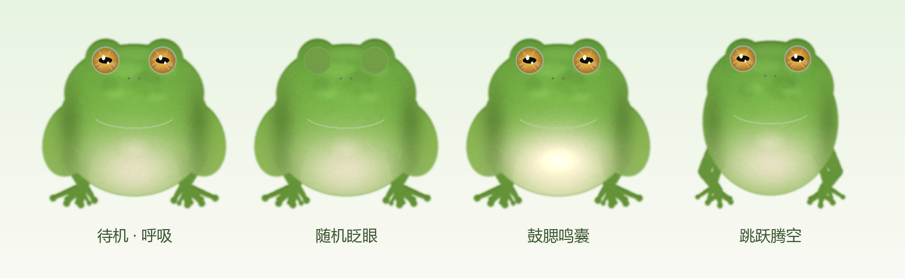

# FrogPet 🐸 Windows 桌面青蛙宠物



一只会在你桌面上跳来跳去、点它会有回应、还能拖着到处放的写实树蛙桌面宠物。
纯 Python + PySide6 实现，可打包为单文件 exe，双击即用。

> **给使用者的一句话说明**：按 `Ctrl+Alt+Q` 退出；彻底卸载运行 `uninstall.bat`。
> 本程序完全离线运行，不联网、不收集任何数据。

---

## ✨ 功能特性

| 功能 | 说明 |
|---|---|
| 🏃 随机跳跃 | 抛物线轨迹，方向、距离随机；起跳下蹲 → 腾空伸展 → 落地缓冲三段动画；自动避开屏幕边缘 |
| 🌿 随身小池塘 | 脚下一汪小水塘：深绿岸边、渐变水面、荷叶、石子、随机泛起的涟漪；跳跃时池塘留在地面，落地正好跳回塘里 |
| 💦 落水水花 | 起跳溅小水花，落地/放下溅大水花（带重力的水珠 + 扩散涟漪 + 白色水冠），配轻柔的"扑通"声 |
| 🖱️ 鼠标拖拽 | 按住蛙身拖到任意位置（可跨屏），松手落地缓冲并溅水花；原地点击则触发回应 |
| 🫧 点击回应 | 弹出气泡文字（呱~ / 干嘛~ / 别戳我~ …）、播放轻柔蛙鸣、转头看你、原地小跳、鼓腮 |
| 😴 待机动画 | 呼吸起伏、随机眨眼、鼓腮鸣囊、接触阴影 |
| 📌 桌面友好 | 始终置顶；透明区域鼠标穿透，只有点到蛙身才触发；不抢焦点、无任务栏图标、不进 Alt-Tab、无托盘 |
| ⌨️ 唯一退出方式 | 全局热键 `Ctrl+Alt+Q`，无论焦点在哪个程序都有效 |
| 🔄 开机自启 | 首次运行自动安装到 `%LOCALAPPDATA%\FrogPet` 并写入 `HKCU\...\CurrentVersion\Run` |
| 🖥️ 多显示器 | 默认在鼠标所在屏活动，偶尔跳去相邻屏幕，拖拽可跨屏搬家 |
| 🔒 隐私安全 | 完全离线、不联网、不收集数据、只写 HKCU 注册表（无需管理员权限） |

---

## 🚀 快速开始

### 源码运行

```bash
# Python 3.11+（3.12 已验证）
pip install PySide6
python main.py
```

### 打包为单文件 exe

```bash
pip install PySide6 pyinstaller
build.bat        # 或手动执行下方命令
```

<details>
<summary>完整 PyInstaller 命令（点击展开）</summary>

```bash
python -m PyInstaller --noconsole --onefile --clean -y --name FrogPet ^
  --icon assets\frog\frog.ico --add-data "assets;assets" ^
  --exclude-module PySide6.QtQml --exclude-module PySide6.QtQuick ^
  --exclude-module PySide6.QtNetwork --exclude-module PySide6.QtMultimedia ^
  main.py
```

> 想进一步降低杀软误报率，可改用 `--onedir` 目录版打包，或对 exe 做代码签名。

</details>

### 分发给朋友

1. 把 `dist\FrogPet.exe` 发给对方，双击即用（自动安装 + 开机自启）；
2. **务必告知对方**：按 `Ctrl+Alt+Q` 退出；彻底卸载运行 `uninstall.bat`；
3. 请仅在对方知情同意的电脑上使用。

### 卸载

运行 `uninstall.bat`：结束进程 → 删除自启项（`HKCU\...\Run\FrogPet`）→ 删除程序目录 `%LOCALAPPDATA%\FrogPet`。

---

## ⚙️ 配置

配置文件位于 `%LOCALAPPDATA%\FrogPet\config.json`，首次运行自动生成，改完重启程序生效：

| 键 | 默认值 | 说明 |
|---|---|---|
| `size` | `170` | 青蛙显示高度（px），建议 120~220 |
| `jump_min` / `jump_max` | `2.0` / `6.0` | 跳跃间隔随机范围（秒） |
| `sound` | `true` | 蛙鸣与落水声开关 |
| `bubbles` | `true` | 气泡文字开关 |
| `multi_screen` | `true` | 是否允许跳去其他显示器 |
| `shadow` | `true` | 接触阴影开关 |
| `pond` | `true` | 池塘与水花总开关 |

---

## 📁 目录结构

```
FrogPet/
├── main.py              # 入口：单实例、日志、首次安装、热键、主窗口
├── pet_window.py        # 透明置顶窗口、跳跃/拖拽状态机、点击穿透、池塘与水花
├── animation.py         # 素材加载、镜像与 alpha 缓存、缓动函数
├── hotkey.py            # Ctrl+Alt+Q 全局热键（Win32 RegisterHotKey，无第三方依赖）
├── autostart.py         # HKCU 开机自启 + 首次安装（复制到 LOCALAPPDATA 后重启自身）
├── config.py            # 配置读写
├── paths.py             # 路径工具（兼容 PyInstaller onefile 的 _MEIPASS）
├── build.bat            # 一键打包
├── uninstall.bat        # 一键卸载
├── assets/
│   ├── frog/            # 四帧姿态 PNG（640×640 透明）+ 阴影 + 图标
│   └── sounds/          # 合成蛙鸣 croak1~3.wav + 落水声 splash.wav
├── tools/
│   ├── render_frog.py   # 参数化青蛙渲染器（生成 assets/frog/*）
│   ├── make_sounds.py   # 蛙鸣/水声合成器（生成 assets/sounds/*）
│   ├── make_preview.py  # 生成 README 预览图
│   └── test_pet.ps1     # 自动化验收（点击/拖拽/跳跃/热键退出）
└── docs/
    └── preview.png      # 预览图
```

---

## 🎨 素材规格与 AI 绘图提示词

### 当前方案：4 姿态帧 + 程序化变形

动画 = 少量关键姿态 + 运行时缩放/挤压/旋转/交叉淡化，比逐帧序列更小、帧间完全一致。

| 文件 | 内容 | 要求 |
|---|---|---|
| `frog_idle.png` | 待机坐姿（睁眼） | 640×640 RGBA 透明 PNG |
| `frog_blink.png` | 闭眼覆盖层 | 与 idle **仅眼睛不同** |
| `frog_puffed.png` | 鼓腮覆盖层 | 与 idle **仅喉部不同** |
| `frog_jump.png` | 腾空伸展 | 脚底与 idle 同一基准线 |
| `shadow.png` | 接触阴影 | 480×160 RGBA |

**硬性约定**：

1. PNG-32 透明通道干净，蛙体外 alpha=0，边缘无白边彩边；
2. 四帧**脚底基准线一致**（当前实现为 y≈608/640），否则落地会悬空或陷入桌面；
3. 四帧必须是**同一只蛙**的连续姿态（同大小、同视角、同光照）；
4. 运行时缩放到 `size`（120~220px），源图 ≥512px 保证清晰；
5. 统一朝向（正面或统一侧脸均可，程序会水平镜像）。

### 可选升级：逐帧序列

想换逐帧动画时按此目录组织，在 `animation.py` 的 `Sprites` 改为加载帧列表即可：

```
assets/frog/idle/idle_000.png ... idle_023.png    # 呼吸循环 24帧 @12fps
assets/frog/jump/jump_000.png ... jump_011.png    # 12帧 @24fps
assets/frog/blink/blink_000.png ... blink_005.png
```

### AI 绘图提示词

> 生成后需抠成透明背景（SD + RemBG / remove.bg，或支持透明的模型）。
> **保证四帧是同一只蛙的关键**：固定同一 seed / 同模型 / 同参数；或先生成 idle，
> 再以 idle 为底图 img2img（重绘幅度 0.3~0.5）只改姿态。提示词用英文效果更好：

**基础角色（每帧都带，保持一致性）：**

```text
Use case: photorealistic-natural
Asset type: desktop pet sprite, full-body isolated subject
Primary request: an adorable realistic green tree frog, front view, full body,
    macro photography quality
Subject: plump small tree frog, moist glossy skin covered in fine granular bumps,
    smooth wet sheen, vibrant yellow-green gradient dorsum (deep green back fading
    to bright chartreuse flanks), pale cream belly and throat, huge round glossy
    golden-amber eyes with dark horizontal pupils and bright catchlights,
    rounded sticky toe pads, subtle dark lateral stripe along the flank
Style/medium: photorealistic macro photo, 3D-render crispness
Lighting/mood: soft studio light from upper left, gentle wet specular highlights,
    friendly and cute but lifelike, not scary
Color palette: yellow-green + chartreuse + cream belly + amber eyes
Constraints: whole frog fully inside frame, centered, feet clearly visible,
    no shadow on background, no props, no text, no watermark
Avoid: cartoon, chibi, oversized head, human-like expression, blur, cluttered background
```

**逐姿态追加：**

| 帧 | 追加描述 |
|---|---|
| `frog_idle` | `sitting upright on its haunches, front legs planted straight, eyes open, calm relaxed pose` |
| `frog_blink` | `identical pose and framing as the idle shot, eyes fully closed, smooth eyelids, everything else pixel-identical` |
| `frog_puffed` | `identical pose as idle, vocal sac under the chin inflated into a round pale balloon, cheeks puffed, eyes slightly squinted` |
| `frog_jump` | `mid-air leap, hind legs fully extended pushing off, front legs reaching forward, body stretched tall, toes spread wide` |

**负面提示词（SD 系）：**

```text
cartoon, chibi, kawaii sticker style, 2D flat, painting, sketch, deformed legs,
extra limbs, missing eyes, scary red eyes, open mouth teeth, wet floor, shadow,
background scenery, gradient background, text, watermark, jpeg artifacts
```

**替换方法**：裁剪到内容包围盒 → 统一缩放 640×640 → 脚底对齐 y≈608 → 覆盖 `assets/frog/` 同名文件，无需改代码。
⚠️ 注意不要重新运行 `tools/render_frog.py`，它会用占位素材覆盖你的 AI 素材。

---

## 🔧 技术实现要点

- **状态机**：`IDLE → CROUCH → JUMP → LAND → IDLE`，点击/拖拽进入 `INTERACT/DRAG`；30ms 定时器驱动，位置沿抛物线 `A→B - (0, 4h·t(1-t))` 插值。
- **点击穿透**：30ms 轮询光标位置，逆变换回姿态源图采样 alpha，动态增删 `WS_EX_TRANSPARENT`——透明处穿透、蛙身可交互（启动时强制初始化该标志，避免整窗挡点击）。
- **拖拽**：按下记录抓取偏移，移动超 8px 进入 DRAG，窗口实时跟随光标；松手夹回屏幕范围并触发落地水花；未移动视为点击。
- **池塘与水花**：QPainter 绘制（岸边环 + 径向渐变水面 + 荷叶/石子 + 涟漪圈），画在"地面点"上，跳跃时与阴影一样留在地面；水珠粒子带重力，涟漪环扩散渐隐。
- **不抢焦点**：`WA_ShowWithoutActivating` + `WS_EX_NOACTIVATE | WS_EX_TOOLWINDOW`（后者同时移出 Alt-Tab 与任务栏）。
- **全局热键**：`RegisterHotKey(MOD_CONTROL|MOD_ALT, 'Q')` + 独立 GetMessage 线程，`WM_HOTKEY` 经 Qt 信号回主线程退出；不依赖 keyboard/pynput，无需管理员。
- **首次安装**：frozen 状态下运行 → 复制自身到 `%LOCALAPPDATA%\FrogPet` → 写自启 → `DETACHED_PROCESS` 重启安装副本 → 原进程退出。
- **声音**：`winsound` 异步播放预合成 wav（蛙鸣 3 变体 + 落水声，峰值 ≤0.22，轻柔不刺耳）。
- **日志**：`%LOCALAPPDATA%\FrogPet\log.txt`，排查问题先看它。

## ❓ 常见问题

| 现象 | 处理 |
|---|---|
| 双击没反应 | 查 `%LOCALAPPDATA%\FrogPet\log.txt`；确认不是被杀软静默隔离 |
| `Ctrl+Alt+Q` 无效 | 组合键被其他软件占用；关闭占用者后重启 FrogPet（日志有 `RegisterHotKey failed`） |
| SmartScreen 提示 | 点"仍要运行"；或用 `--onedir` 重打包 / 代码签名 |
| 被全屏游戏挡住 | 独占全屏会盖住一切置顶窗口，属系统行为；无边框/窗口化游戏不受影响 |
| 想暂时关掉自启 | 任务管理器 → 启动应用 → 禁用 FrogPet，或运行 uninstall.bat |
| 青蛙出现在副屏 | 它生成在鼠标所在屏，拖回来即可 |

## 📜 许可与使用边界

- 仅供学习交流与个人使用；**仅可在电脑所有者知情同意的前提下安装使用**。
- 本程序刻意保持了"完全可控"：可见的退出热键、一键卸载、无任何隐藏行为——请保留这些设计。
